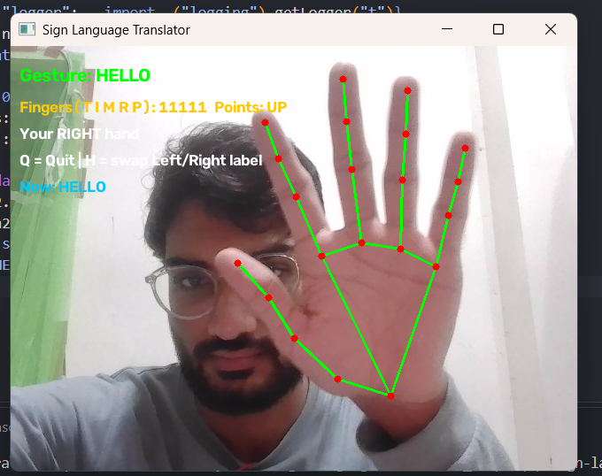
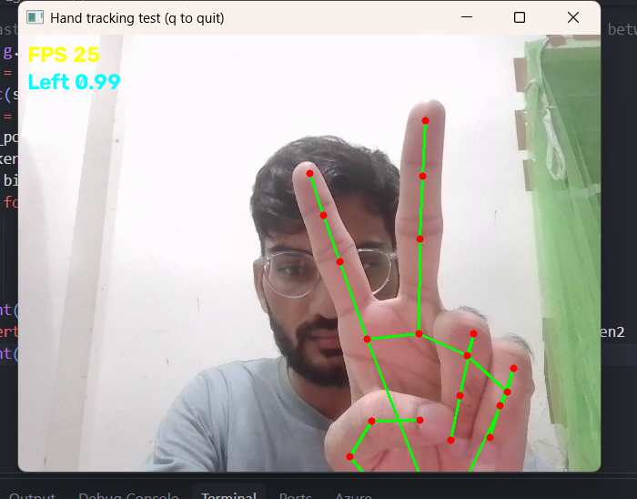
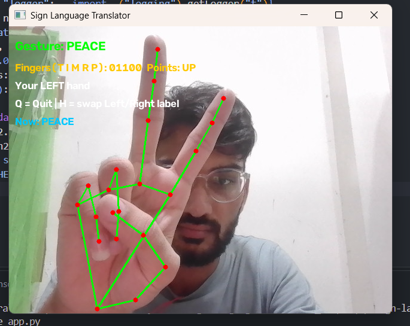
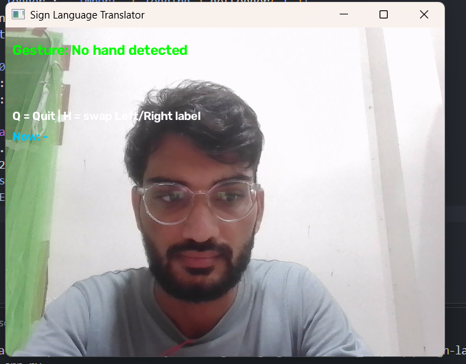

<!-- mg-header -->
<p align="center">
  
</p>

<p align="center">
  
  
  
  
</p>

<p align="center">
  <a href="https://mohitgora950.github.io"><b>🌐 Portfolio</b></a> · <a href="https://github.com/mohitgora950"><b>👤 More projects</b></a> · <a href="https://www.linkedin.com/in/mohit-goraaaa1234/"><b>💼 LinkedIn</b></a> · <a href="mailto:mohitgora950@gmail.com"><b>📫 Hire me</b></a>
</p>

> **TL;DR:** Recognises hand gestures from a webcam in **real time**, shows them as text and **speaks them aloud**, all offline. Pipeline: OpenCV → MediaPipe HandLandmarker (21 landmarks) → orientation-aware classifier with hysteresis smoothing → background text-to-speech.

### 📸 Screenshots

<table>
<tr><td align="center" width="50%"><br /><sub><b>Live gesture recognition</b></sub></td><td align="center" width="50%"><br /><sub><b>Hand landmark detection</b></sub></td></tr>
<tr><td align="center" width="50%"><br /><sub><b>More gestures</b></sub></td><td align="center" width="50%"><br /><sub><b>No hand in frame</b></sub></td></tr>
</table>

---
<!-- /mg-header -->

# Sign Language Translator

Real-time sign gesture recognition from webcam, shown as text and spoken aloud.

**Status:** Early prototype. The current webcam application includes hand
tracking, a custom rule-based vocabulary, per-finger smoothing, gesture
stabilization, interruptible offline text-to-speech, and diagnostic logging.
The project roadmap is in `docs/ROADMAP.md`.

## Current pipeline

```text
Webcam
  -> OpenCV frame capture and mirrored display
  -> MediaPipe Tasks HandLandmarker
  -> 21 normalized hand landmarks
  -> Orientation/hand-aware rule-based classifier
  -> Finger hysteresis and majority-vote smoothing
  -> Stable gesture transition detection
  -> On-screen gesture text
  -> Interruptible background speech controller
  -> Windows SAPI.SpVoice offline text-to-speech
```

The classifier uses five finger states, four hand-pointing orientations, and
two corrected hand sides. This provides a custom vocabulary of up to 256
pose combinations. It is a project-specific vocabulary and **not real ASL**.

Named poses currently include:

- `HELLO` - four fingers extended
- `I LOVE YOU` - thumb, index finger, and pinky extended
- `YES` - thumb-up fist
- `NO` - thumb-down fist
- `PEACE`, `ONE POINT`, `FIST`, `ROCK ON`, `CALL ME`, `OK`, and number poses
- Additional words selected from the custom orientation/hand vocabulary

For the professor/viva-safe demo, offensive labels are replaced by clean
labels such as `NOT HAPPY`, `RUDE`, `NONSENSE`, and `GO AWAY`. This behavior is
controlled by `PROFESSOR_MODE` in `src/signlang/gestures.py`.

This is currently a prototype, not a complete ASL recognition system. The
classifier uses landmark geometry and a custom vocabulary; a trained PyTorch
model is planned for a later stage.

## Main files

| File | Purpose |
|---|---|
| `scripts/sign_language_app.py` | Main webcam, classification, display, logging, and speech application |
| `src/signlang/hand_tracker.py` | MediaPipe Tasks HandLandmarker wrapper and hand skeleton drawing |
| `src/signlang/gestures.py` | Custom vocabulary, finger ratios, orientation, handedness correction, hysteresis, and majority smoothing |
| `src/signlang/speech.py` | Interruptible background Windows SAPI speech controller |
| `scripts/test_hand_tracking.py` | Standalone webcam and hand-landmark tracking test |
| `scripts/check_env.py` | Python, package, model, webcam, and TTS environment checks |
| `scripts/download_models.py` | Downloads the MediaPipe hand-landmarker model |
| `tests/test_gestures.py` | Webcam-free synthetic tests for vocabulary, orientation, handedness, noise filtering, and fast gestures |
| `models/hand_landmarker.task` | MediaPipe hand-landmarker model file |
| `docs/ROADMAP.md` | Planned project stages |
| `docs/TECH_DECISIONS.md` | Technology choices and rationale |
| `docs/ORIGINALITY.md` | Originality, licensing, and reference notes |

## Gesture and speech behavior

Each finger uses separate open and close thresholds (hysteresis), which helps
prevent flicker when a fingertip is close to a boundary. The classifier also
keeps a short recent-history window and returns `UNCERTAIN` while frames
disagree during movement. `UNCERTAIN` frames do not replace the last stable
gesture.

The application confirms a candidate gesture after approximately 0.1 seconds
of stability. A held gesture is spoken once, while a different stable gesture
is spoken again. A stable no-hand or unknown-gesture state clears the speech
state, allowing the same gesture to be spoken again after a clear transition.
If the hand disappears for at least 0.15 seconds, current speech is stopped
and pending speech is dropped.

Speech is handled by `SpeechController` in a background thread using
`win32com.client` and Windows `SAPI.SpVoice`. New speech replaces older speech
and can interrupt it immediately; the webcam loop never waits for speech to
finish.

Frames are mirrored with `cv2.flip(frame, 1)` for a natural selfie-camera
view. MediaPipe handedness is corrected centrally with `SWAP_HANDEDNESS` in
`src/signlang/gestures.py`; press `H` in the application to toggle the
left/right label correction at runtime. The window shows the corrected hand
side, finger bit pattern, and pointing orientation. Handedness, confidence,
candidate changes, stable transitions, speech queue events, interruptions,
and speech errors are logged for debugging.

## Testing

The gesture test file uses synthetic landmarks, so the landmark-classification
part does not require a webcam:

```bash
python tests/test_gestures.py
```

The test coverage includes all orientations and both hand labels, named
gestures, the professor-safe vocabulary, aspect-ratio correction, handedness
swapping, thumb-down detection, noisy landmarks, temporal smoothing, and
short fast gesture sequences. The current test file also loads
`GestureState` by reading the application source. Its path currently assumes
`tests/sign_language_app.py`, while the actual application is at
`scripts/sign_language_app.py`; therefore the test currently stops at that
path lookup unless the test path is corrected. The source files themselves
remain unchanged by this documentation update.

## Setup (Windows, VS Code)

Python 3.12 or newer is recommended.

```bash
py -3.12 -m venv .venv
.venv\Scripts\activate
pip install -r requirements.txt
python scripts/download_models.py
python scripts/check_env.py
python scripts/test_hand_tracking.py
```

Run the main application:

```bash
python scripts/sign_language_app.py
```

Press `Q` in the OpenCV window to quit.
Press `H` to toggle the left/right hand-label correction.

On Windows, `pip install torch` normally installs the CPU build. That is
enough for the current landmark-based project.

## Requirements

The project uses Python and these main libraries:

- MediaPipe Tasks API for hand landmarks
- OpenCV for webcam capture and display
- NumPy for landmark calculations
- PyTorch and scikit-learn for planned training and evaluation stages
- `pyttsx3` with Windows SAPI5 for offline speech
- CustomTkinter for a planned desktop UI

The complete dependency list is in `requirements.txt`.

## Planned roadmap

1. Webcam hand tracking and project scaffold
2. Landmark data collection per person
3. Landmark normalization and PyTorch MLP training
4. Honest evaluation and confusion matrix
5. Real-time trained-model inference with smoothing
6. CustomTkinter UI and integrated text-to-speech
7. ONNX export and FPS/latency benchmarking
8. Final report, presentation, and viva documentation

## Credits and licence
I independently designed and implemented this project to address a real-world
accessibility problem: helping people who cannot speak communicate through
recognized hand gestures and spoken output. I created the application code,
gesture rules, smoothing logic, speech flow, tests, and project structure
myself for this project. No source code, gesture implementation, design,
content, or inspiration was taken from another repository, public project, or
other external project.

The project uses third-party libraries as dependencies. Those libraries keep
their own licences (MediaPipe: Apache-2.0, PyTorch: BSD-3, OpenCV:
Apache-2.0). A `LICENSE` file is not currently present in the project root, so
the repository should not claim an MIT licence until that file is added.
